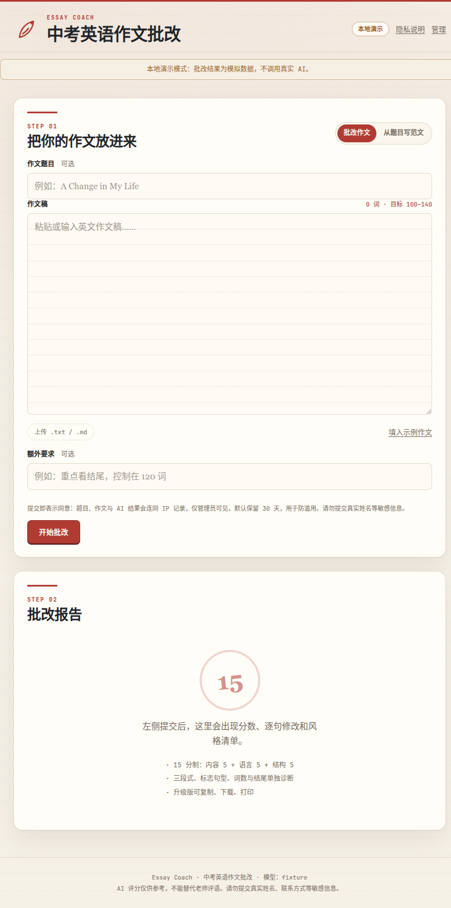
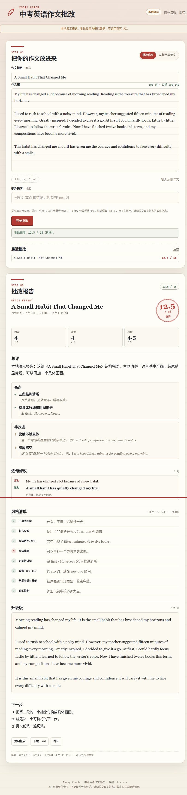
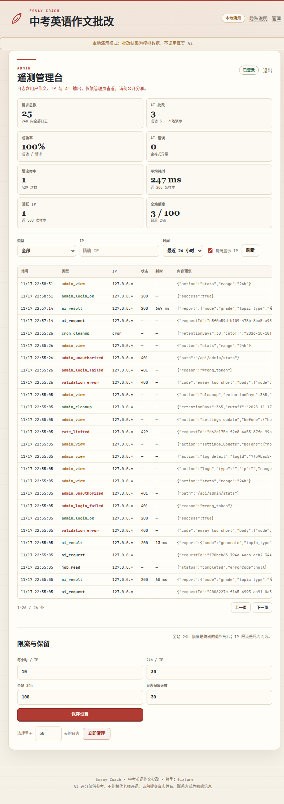

# Essay Coach

[](https://github.com/FrankWkd-Plus/essay-coach/actions/workflows/test.yml)

一个面向初中生的 serverless 英语作文批改站：粘贴或上传作文稿，云端 AI 按 **15 分制中考标准**批改，并单独检查三段式、标志句型、具体数字、比喻、时间推进、词数与结尾升华。

前端是原生 HTML/CSS/ES Modules，后端是一个 **Cloudflare Worker**：Static Assets 托管页面，D1 存遥测与任务，Cron Triggers 每日清理过期日志，Workers AI 在未配置外部 Key 时兜底。没有自建服务器，也没有 Docker。

## 预览

以下截图来自本地 fixture 模式（模拟批改结果）：

| 首页 | 批改报告 | 管理台 |
| --- | --- | --- |
|  |  |  |

## 功能

- **批改作文**：题目可选，作文稿必填；返回总分、内容/语言/结构三项分数、总评、亮点、待改进、逐句修改、8 项风格清单、升级版全文。
- **从题目写范文**：只填题目即可生成 100–140 词的三段式范文，附提纲与可迁移句型。
- **文本 + `.txt/.md` 上传**：不做图片 OCR；拍照稿请先转成文字。
- **可恢复任务**：客户端生成 `requestId`；超时或断网后查询 `/api/jobs/{id}`，避免重复扣费。
- **报告导出**：复制 Markdown、下载 `.md`、A4 打印样式、最近 8 条本地记录。
- **遥测管理台**：请求总数、AI 调用、成功率、错误、限流命中、平均耗时、活跃 IP 样本、全站额度；日志可按类型/IP/时间筛选并查看完整内容。
- **防滥用**：每 IP 每小时/24h 限额、全站 24h 额度、32KB 请求上限、同源写保护、CSP、管理员口令常量时间比较、登录失败锁定、SSRF 防护。
- **公开可访问**：`*.workers.dev` 默认公开；管理台由 `ADMIN_TOKEN` 保护。

## 架构

```
browser (public/, ES Modules)
   │  same-origin /api/*
   ▼
Cloudflare Worker (src/worker.js)
   ├── fetch: /api/health, /api/grade, /api/jobs/:id, /api/admin/*
   ├── D1: request_logs / grading_jobs / settings
   ├── Workers AI: @cf/qwen/qwen3-30b-a3b-fp8 (no-key fallback)
   └── external: OpenAI-compatible /chat/completions (DeepSeek by default)
   scheduled: daily cron cleanup (UTC 03:15)
```

## 本地开发

要求 Node 20+。本地开发使用 fixture，不调用真实 AI，也不需要 Cloudflare 登录：

```bash
cp .dev.vars.example .dev.vars
npm install
npm run db:local
npm run dev:local       # http://127.0.0.1:8787
```

本地管理员口令是 `.dev.vars` 里的 `ADMIN_TOKEN`（示例值 `local-admin-token-change-me`）。打开 `/#/admin` 即可查看本地 D1 里的日志。

> `npm run dev` 使用主 `wrangler.toml`，包含远端 AI binding，需要先 `npx wrangler login`；离线开发请用 `npm run dev:local`。

## 部署到 Cloudflare

1. 登录 Cloudflare：

```bash
npx wrangler login
```

2. 创建 D1，并把输出里的 `database_id` 填到 `wrangler.toml` 的 `[[d1_databases]]` 中（替换全零占位符）：

```bash
npx wrangler d1 create essay-coach-db --location apac
```

3. 建表：

```bash
npm run db:remote
```

4. 生成管理员口令并设置 Secret（`.admin-token` 与 `.env.production` 都已 gitignore）：

```bash
python3 -c "import secrets; print(secrets.token_hex(32))" > .admin-token
chmod 600 .admin-token
printf 'ADMIN_TOKEN="%s"\n' "$(cat .admin-token)" > .env.production
npx wrangler deploy --secrets-file .env.production
```

5. 打开 Wrangler 输出的 `https://essay-coach.<你的子域>.workers.dev`，管理台在 `/#/admin`，口令是本地 `.admin-token` 文件内容。

> 本仓库交付时，工作目录里已经生成 `.admin-token` 和 `.env.production`（均不入库）；如果文件不存在，按第 4 步重新生成即可。

### 可选：接入 DeepSeek 提升质量

不配置 Key 时使用 Workers AI 的 Qwen3 30B（免费额度 10,000 Neurons/天，质量低于 DeepSeek）。配置后自动优先走外部接口：

```bash
npx wrangler secret put AI_API_KEY
```

默认 `AI_API_URL=https://api.deepseek.com/chat/completions`、`AI_MODEL=deepseek-chat`，可在 `wrangler.toml` 的 `[vars]` 里改成任意 OpenAI 兼容服务。若供应商不支持 `response_format`，把 `AI_JSON_MODE` 设为 `false`。

### 轮换管理员口令

```bash
npx wrangler secret put ADMIN_TOKEN
```

## 遥测与隐私

D1 中三张表：

- `request_logs`：`ip`、`user_agent`、`referer`、`country`、`event_type`、完整 `content`、HTTP 状态、耗时、`job_id`、`meta`（colo/asn/origin/requestId）。
- `grading_jobs`：按 `requestId` 幂等保存题目、作文、要求、状态、完整结果、模型与耗时。
- `settings`：限流与保留配置（每小时/IP、24h/IP、全站 24h、日志保留天数、上次清理时间）。

事件类型包括 `ai_request`、`ai_result`、`ai_error`、`ai_invalid_output`、`validation_error`、`rate_limited`、`job_read`、`admin_login_ok`、`admin_login_failed`、`admin_unauthorized`、`admin_view`、`admin_cleanup`、`cron_cleanup`、`cron_error`。

- 题目、作文、额外要求和 AI 完整结果都会写入日志；这是用户明确要求的防滥用审计能力。
- IP 优先取 Cloudflare 的 `CF-Connecting-IP`；管理台列表默认掩码显示，日志详情也跟随“掩码显示 IP”开关。
- 默认保留 30 天：每日 Cron 清理 + 管理台手动清理。Cron 时间是 UTC 03:15（北京时间 11:15）。
- 管理台提示“日志含用户作文、IP 与 AI 输出，请勿公开分享”。请勿把管理台截图或日志内容发到公开渠道。

## 安全设计

- 外部 AI Key 只存在 Worker Secret，前端产物与公开仓库不含 Key。
- 管理接口要求 `x-admin-token`，令牌先 SHA-256 再做常量时间比较；只存 `sessionStorage`，不进 URL。
- 登录失败每 IP 10 分钟 5 次、全站 50 次；所有失败写日志但不记录令牌。
- 全站日额度是成本兜底；IP 限流是尽力而为（Cloudflare 边缘 IP 比自建代理可信，但仍不是身份）。
- 所有用户/AI 文本用 `textContent` 渲染，不用 `innerHTML`；日志列表只取前 500 字符，详情单独读取。
- CSP、`X-Frame-Options: DENY`、`nosniff`、Referrer-Policy、Permissions-Policy 通过 `public/_headers` 与 `index.html` meta 生效。
- 外部 AI URL 强制 HTTPS，拒绝 IP 字面量、私有主机、URL 凭据和重定向；不把用户 URL 变成带 Key 的代理。
- 评分由服务端重新归一化：子项 0–5、0.5 步长、总分服务端相加，prompt 注入无法伪造总分。
- 不做未知写操作自动重试；AI 超时后只能查询已保存的任务状态。

## 测试

```bash
npm test
```

47 个 Node 单元测试覆盖词数、输入边界、评分归一化、JSON 提取、prompt 关键项、外部/内置 AI 响应解析、URL 防护、限流判断、IP 掩码、管理员鉴权与日志写入。

本地端到端已在 `wrangler dev` 验证：批改、生成范文、幂等重放、任务查询、400/401/404/405/429、管理台统计/日志详情/设置/清理、Cron 清理、D1 完整遥测。

## 目录

```
public/                 静态站点（index.html / styles.css / js / favicon / _headers）
src/worker.js           Worker 入口（fetch + scheduled）
src/routes.js           API 路由与批改流水线
src/essay.js            输入校验、词数、评分归一化、JSON 提取
src/prompts.js          15 分制评分 + 风格清单 + 输出 schema
src/ai.js               外部 OpenAI 兼容 + Workers AI 兜底 + URL 防护
src/logs.js             遥测写入/查询/统计/IP 掩码
src/limits.js           限流配置与判断
src/admin.js            管理员鉴权与接口
src/cleanup.js          Cron / 手动清理
schema.sql              D1 建表语句
wrangler.toml           生产配置（D1 + AI + Cron + vars）
wrangler.local.toml     本地 fixture 配置（无 AI binding）
tests/                  node --test
```

## 已知限制

- Workers AI 兜底的 JSON 稳定性与评分质量低于 DeepSeek；生产建议配置 `AI_API_KEY`。
- 不做图片 OCR、多用户账号、云端历史同步、付费系统。
- Workers AI 免费额度 10,000 Neurons/天；全站默认 100 次/24h，防止额度被刷爆。D1 免费额度足够小流量。
- 日志会保存完整作文与 IP，这是需求本身；如果部署给未成年人使用，请在页面/学校层面补充监护人或合规告知。

## License

MIT
